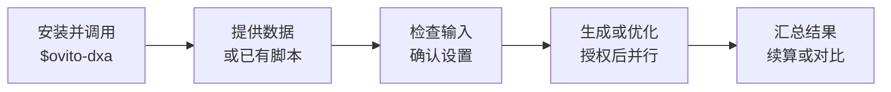

# OVITO DXA：Python 位错分析与提取并行优化，提升运行效率

**关键词：** lammps后处理、ovito快速提取位错、ovito-python批量处理。

**OVITO + Python + DXA** 可以自动提取和分析位错数据，用于 LAMMPS 模拟结果的后处理。在 Python 环境中安装并导入兼容的 OVITO 包后，可使用 DXA 识别位错线、Burgers 矢量及其所属类型；按需导出位错线的几何位置，并在明确线长和统计体积的条件下计算位错密度。

DXA 计算本身需要时间和内存。一些默认流程或大模型生成的代码，即使在参数适合体系且识别结果正确的情况下，也可能由于逐帧重复创建流水线等原因运行较慢；当需要处理多组独立的 LAMMPS 轨迹时，耗时尤为明显。为此，本技能在保持已确认的分析设置和结果含义的前提下，主要从两个方向优化：

1. **默认逐工况处理、工况内多进程**：每个工况根据可用 CPU、内存和待处理帧数等条件调整进程数。单构型或资源受限时可能只使用一个进程。
2. **融合[网页改进版](https://blog.csdn.net/wcget123/article/details/135202165)的优化思路**：各工作进程建立并复用流水线，DXA 只添加一次；同一帧的多个指标共享计算结果，最后统一汇总全部工况。

实际运行效率取决于数据和机器，可按需选择代表帧实测，不保证固定加速倍数。使用已有的兼容 OVITO 环境即可；需要安装时可参考 [OVITO 官方安装说明](https://docs.ovito.org/python/introduction/getting_started/installation.html)，并确认版本兼容性，技能不会自动升级现有环境。

## 使用流程



## 如何使用？

像使用其他 Codex 技能一样，[安装技能](#安装技能)后，在对话中调用 `$ovito-dxa`，并提供要分析的数据或已有脚本。它可以帮助生成面向当前任务的并行分析流程，也可以审查和改进已有脚本。

例如：

> 使用 $ovito-dxa 检查我提供的 LAMMPS 轨迹，确认必要设置后统计各帧位错长度和位错密度；请按我的电脑资源安排并行处理。

> 使用 $ovito-dxa 审查我提供的 DXA 脚本，在保留分析设置和输出含义的前提下改进运行效率。

技能会先检查现有信息，对无法可靠判断的分组、参考晶格、原子选择、单位和输出等设置进行确认。Notebook 可采用 `%%writefile DXA_Multiprocessing.py` 和 `%run DXA_Multiprocessing.py`，详见 [Notebook 入口](#notebook-入口)及[合成示例](examples/dxa_walkthrough.ipynb)。

## 能得到什么？

- 逐帧位错总长度、Burgers 矢量族分类长度，以及定义明确时的整盒位错密度；记录帧、模拟步、状态和分析设置。
- CSV 统计、运行元数据与检查点；可选逐线属性和 CA 位错网络。中断后可在检查输入和设置兼容性后续算。
- 按需对代表帧比较性能与结果一致性，报告实测耗时和内存。优化通过复用流水线、共享同一帧计算结果及并行调度减少重复工作；**实际速度和内存占用取决于数据与机器，不保证固定加速倍数**。

溶质或氢相关分析需要另行确认物理定义并生成专用代码，本版不内置通用氢距离、富集或位错跨帧追踪算法。当前已验证环境与限制见 [VALIDATION.md](VALIDATION.md)。

## 内容与适用边界

- 技能入口：[SKILL.md](skills/ovito-dxa/SKILL.md)。
- 输入检查：检查解释器、资源、源文件、帧及必要属性，不执行 DXA。
- DXA 运行：默认逐工况处理，工况内按独立帧并行；支持兼容性检查后的续算和按需代表帧性能比较。
- 输出：统计 CSV 长表、运行元数据与检查点；按需导出逐线属性和 CA 位错网络。
- 性能报告：独立 HTML、JSON 与 CSV，按需展示代表帧的真实耗时、峰值 RSS、结果一致性及本次样本的推荐配置。没有实测或未通过比较时不声称提速。
- 溶质分析：提供按需询问、专用代码生成及验证规则；第一版不内置通用氢距离、富集或位错追踪算法。

内置运行器处理 LAMMPS data/dump。其他格式先确认 OVITO 读者能力，再单独适配。参考晶格支持由实际 OVITO 版本决定；不对一般晶界、多相界面或不支持的晶格作越界解释。

## 安装技能

在支持 `skill-installer` 的 Codex 中，可以直接请求：

> 使用 skill-installer，从 https://github.com/pancake-github/ovito-dxa-skill/tree/v0.1.3/skills/ovito-dxa 安装 ovito-dxa 技能。

安装版本为 `v0.1.3`，安装目标是仓库中的 `skills/ovito-dxa` 目录，包含入口、参考资料及两个辅助脚本。安装后按宿主要求重新加载技能，再使用 `$ovito-dxa`。也可将该完整目录放入宿主的技能发现目录；不同机器不共享任何固定盘符。

技能不会替使用者安装或升级科学计算环境。请使用已有且能导入 `ovito`、`numpy`、`psutil` 的 Python 3.10 或更新解释器。OVITO 的版本能力需先检查；当前验收目标为 Windows、Python 3.10.19、OVITO 3.14.1。Linux 采用兼容实现，但测试状态以验收记录为准。

## 可运行的合成示例

在已正常激活 OVITO 环境的终端中获取仓库。以下命令使用仓库自身的路径，不指向私有研究数据：

```powershell
git clone --branch v0.1.3 --single-branch https://github.com/pancake-github/ovito-dxa-skill.git # 获取指定版本和公开合成示例生成器。
Set-Location ovito-dxa-skill # 将当前目录切换到本仓库根目录。
python tests/make_examples.py --output examples/generated # 生成实际数据及与它们对应的完整清单。
```

生成器提供 `static.json`（单构型）、`task.json`（多组数据）和 `sequence.json`（分帧序列）。合成案例中的晶格、单位及周期边界仅适用于这些演示模型，不是使用真实数据时的默认值。

先进行只读检查，查看分组及缺失信息：

```powershell
python skills/ovito-dxa/scripts/inspect_inputs.py --paths examples/generated/bcc.dump examples/generated/fcc.data # 检查两组有效示例，不执行 DXA。
```

确认任务清单后直接处理全部选定帧，默认不先执行串行基线或性能比较：

```powershell
python skills/ovito-dxa/scripts/run_dxa.py --config examples/generated/task.json # 默认使用 run 模式及清单中的资源设置。
```

默认 `resources.scheduling="case_sequential"`：依次处理工况，每个工况内通过多进程处理帧，一个工况的进程池结束后再处理下一个。每个工况开始前刷新 CPU、可用内存和该工况的待处理帧块，只按该工况估算资源。多个工况的小型统计集中汇总，逐帧检查点保留，CA 按需独立写出。

默认 `workers="auto"`、每个 worker 使用 1 个 OVITO 线程。运行器根据当前进程可用 CPU、剩余帧块、可用内存和平台上限自动选择进程数，预留约 10% 的可用逻辑 CPU 和 25% 的可用内存；用户指定正整数时，它作为额外上限。单构型或资源约束也可能只启动 1 个 worker，这不是额外串行基线；内存估计不足以启动 1 个 worker 时会明确停止。选择结果和限制原因会在启动时显示，并写入 `execution.json` 的 `resource_plan`。用户确实需要比较工况内的进程配置时，才可选用 benchmark；它从每组所选范围选首、中、末去重候选帧，默认再全局均匀限额至 6 帧；未抽到的工况并未因此完成性能验证，不对全部帧执行串行基线。

```powershell
python skills/ovito-dxa/scripts/run_dxa.py --config examples/generated/task.json --mode benchmark # 仅按需比较代表帧，结果写入 benchmark 目录。
```

benchmark 的 HTML 报告可在浏览器直接打开，无联网或绘图依赖；未执行或对照失败时不能声称提速。它不自动尝试跨工况调度。
已有清单如果仍写有 `"workers": 2`，它会保留为显式并发上限；需要自动选择时应改为 `"workers": "auto"`。新生成的清单和运行器缺省值均已使用 auto。

用户希望比较不同工况的调度方式时，可明确请求 `scheduling` 模式；它只运行代表帧，比较逐工况与跨工况共同调度：

```powershell
python skills/ovito-dxa/scripts/run_dxa.py --config examples/generated/task.json --mode scheduling # 按需双轮比较调度方式，不执行全量运行。
```

该模式执行两轮配对比较，第二轮交换执行顺序。只有全部结果一致且资源合格，同时跨工况较慢一轮仍快于逐工况较快一轮，才视作满足本次样本的收益判据；无需固定百分比或工况数量门槛。报告默认位于 `output_dir/scheduling/report.json` 和同目录 HTML。若用户明确选择 `resources.scheduling="cross_case"`，还需在 `resources.scheduling_evidence` 提供当前任务的报告路径；run/resume 会验证输入科学指纹、资源策略、运行机器、报告摘要及收益是否匹配，不满足时停止。小工况多只是值得对比的线索，不自动切换调度；样本结果也不保证全轨迹收益。

中断后使用相同清单和 `--mode resume`。输入、科学设置或软件版本发生变化时，不应复用旧结果；新建独立输出目录。运行器不会为了重跑自动删除已有结果。

## Notebook 入口

从仓库根目录、已正常激活并能导入 OVITO 的环境启动 Notebook。为保证每次演示有独立结果目录，第一个单元生成全新的合成输入，并复制执行所需的两个运行器模块：

```python
from datetime import datetime  # 用当前时间生成新的演示目录名称。
from pathlib import Path  # 处理当前仓库与示例目录。
import shutil  # 复制仓库中的运行器文件。
import subprocess  # 调用示例生成器创建真实演示数据。
import sys  # 使用当前 Notebook 的 Python 解释器。
repo = Path.cwd().resolve()  # 此单元要求当前目录为已克隆的仓库根目录。
generator = repo / "tests" / "make_examples.py"  # 指向仓库自带的示例生成器。
assert generator.is_file(), "请先将 Notebook 工作目录切换到仓库根目录。"  # 在找不到实际生成器时停止。
work_dir = repo / "examples" / ("notebook_generated_" + datetime.now().strftime("%Y%m%d_%H%M%S_%f"))  # 创建本次独立的示例工作路径。
subprocess.run([sys.executable, str(generator), "--output", str(work_dir)], check=True)  # 生成可实际读取的数据和任务清单。
runtime_dir = work_dir / "dxa_runtime"  # 设置此次演示的运行器目录。
runtime_dir.mkdir()  # 创建新的运行器目录，不覆盖已有内容。
for name in ("run_dxa.py", "inspect_inputs.py"):  # 依次复制运行器与其输入检查模块。
    shutil.copy2(repo / "skills" / "ovito-dxa" / "scripts" / name, runtime_dir / name)  # 保留模块名称供子进程导入。
```

第二个单元进入刚生成的目录：

```python
%cd -q $work_dir
```

第三个单元用 IPython 单元魔法命令写入薄入口。工作函数由相邻 `dxa_runtime` 中可导入的 `run_dxa.py` 提供：

```python
%%writefile DXA_Multiprocessing.py
__spec__ = None  # 将 IPython 重复执行的入口明确标为脚本，供 Windows spawn 读取。
from pathlib import Path  # 读取本次生成的示例目录。
import sys  # 设置模块搜索路径，并保留可选命令行参数。
import multiprocessing as mp  # 使用 Windows 标准入口保护。
if __name__ == "__main__":  # 只在入口程序中启动计算，避免子进程重复启动。
    work_dir = Path(__file__).resolve().parent  # 使用脚本所在目录，不依赖后续工作目录变化。
    runtime_dir = work_dir / "dxa_runtime"  # 定位前一步复制的运行器模块。
    config = work_dir / "task.json"  # 使用前一步已实际生成的演示清单。
    if not (runtime_dir / "run_dxa.py").is_file() or not config.is_file():  # 确认运行器和清单确实存在。
        raise FileNotFoundError("请先运行生成示例目录的单元。")  # 缺少输入时停止，避免猜测路径。
    sys.path.insert(0, str(runtime_dir))  # 让父进程及 spawn 子进程可以导入运行器模块。
    import run_dxa  # 从可导入模块加载入口，worker 也由该模块提供。
    if Path(run_dxa.__file__).resolve() != (runtime_dir / "run_dxa.py").resolve():  # 防止同一内核缓存了其他目录的旧模块。
        raise RuntimeError("当前内核已加载另一份 run_dxa；请重启内核后从头执行。")  # 避免静默使用旧实现。
    mp.freeze_support()  # 保留 Windows 独立脚本入口保护。
    run_dxa.main(["--config", str(config), *sys.argv[1:]])  # 默认执行 run；可选参数按原样传给运行器。
```

第四个单元执行已保存的薄入口：

```python
%run DXA_Multiprocessing.py
```

`%%writefile` 用于写文件，`%run` 用于执行脚本；多进程来自运行器中的进程池，单靠 `%run` 不会创建并行。工作函数必须位于可导入的 `run_dxa.py` 模块，不能放在 Notebook 临时 `__main__` 中。实际环境仍应通过小规模运行检查导入、输出和结果状态。

真实项目的清单应在预检与使用者确认后生成，不能直接把演示清单中的科学设置套到另一体系。完整字段和模式见 [任务清单](skills/ovito-dxa/references/task-manifest.md)。

## 阅读报告

按需执行 benchmark 时，倍率为代表帧工况内单进程参考耗时除以候选耗时，小于 1 表示候选更慢。benchmark 的基线是**此辅助脚本的单进程实现**，不是博客原版或使用者的旧代码；若没有对旧代码实测，不能报告“相对于旧代码提升”。

计时包含候选导入、读取、计算、传输和落盘；共同检查及哈希成本单列。峰值 RSS 是进程树定时采样估计，可能遗漏瞬时峰值，也可能重复计算共享页。首、中、末候选帧经全局限额后的样本最快配置不保证在整条轨迹上最快；未抽到的工况不在本次性能验证范围内。

总线长、分类长度及定义明确的密度按固定容差比较；结果不一致的候选不被推荐。错误帧、无晶态原子与成功的零位错分别显示。线 ID 和方向可能变化，不能当作跨帧追踪。

## 当前验收状态

验收数据、实际测试配置及尚未覆盖的环境见 [VALIDATION.md](VALIDATION.md)。资源设置和 Notebook 入口变更后，应以对应版本的最新实测记录为准；不能把先前版本的结果直接视为新版本的验收。

在已激活的 OVITO 环境中可复现自动测试：

```powershell
python -m unittest discover -s tests -p "test_*.py" -v # 生成临时合成输入并验证实际CLI与故障处理，不读取私人数据。
```

## 方法来源与许可

[用户提供的 CSDN 文章](https://blog.csdn.net/wcget123/article/details/135202165)的改进版将 DXA 修饰器移到帧循环外、汇总结果后集中写出；该示例本身按帧串行执行。本仓库独立实现这些思路，并通过 `spawn` 进程池为每个 worker 创建和复用私有流水线，使同一帧的统计与几何使用同一次计算结果；小型统计集中输出，CA 独立写出，任务有界提交并保存逐帧检查点。保留的是这些可复用的优化思路，不采用逐帧重新导入、一次提交全部任务、将全部大数组保存在内存或固定层等特定科学定义。博客中的 BCC、14、9 等设置不自动用于其他体系，应根据具体材料和分析要求确认。

资源自动配置使用启发式估算，不能保证内存峰值或最快速度：每个 worker 按 `384 MiB + 4096 B × 估计最大粒子数` 估算，默认逐工况依据当前工况首帧元数据及可覆盖文本轨迹的全部原子数头。未覆盖的文件不能保证发现最大帧；具体覆盖情况记入 `resource_plan`。[性能方法](skills/ovito-dxa/references/performance.md)解释 CPU 和内存预算，以及断点续算的重新评估。

参考 [OVITO DXA 官方说明](https://docs.ovito.org/reference/pipelines/modifiers/dislocation_analysis.html)、[OVITO 性能指南](https://www.ovito.org/manual/python/introduction/scripting/performance.html)及 [Python 进程池文档](https://docs.python.org/3/library/concurrent.futures.html#processpoolexecutor)。
本仓库以 [MIT](LICENSE) 许可发布。OVITO 及其他依赖各自的许可仍适用；发表研究结果时应按照 OVITO 官方页面引用 DXA 算法论文。公共示例使用合成数据，私有研究数据不随仓库发布。
